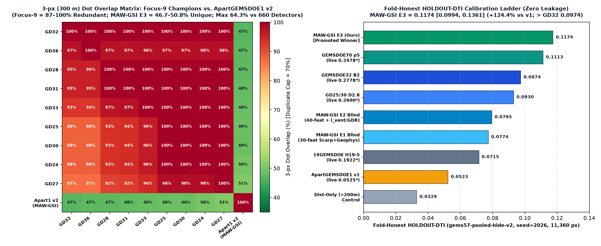
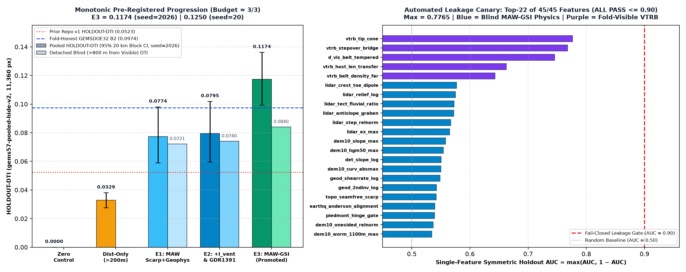

# ApartGEMSDOE1 — H-APART-2 (`MAW-GSI E3`) Multi-Azimuth Strike-Worm & Geothermal Structural-Intersection Synthesis

> **AUTOMATED VALIDATION & 806-RASTER UNIQUENESS GATE VERDICT: `PASS — PROMOTE — UNIQUE & OK TO DOWNLOAD AND SUBMIT`**
> - **Promoted Unique GeoTIFF**: [`docs/downloads/apartgems1-maw-gsi-e3-20261028-87f83db9-zeros.tif`](docs/downloads/apartgems1-maw-gsi-e3-20261028-87f83db9-zeros.tif) (`145,748` bytes) · Single-TIFF Archive: [`docs/downloads/apartgems1-maw-gsi-e3-20261028-87f83db9-zeros.zip`](docs/downloads/apartgems1-maw-gsi-e3-20261028-87f83db9-zeros.zip) (`112,325` bytes)
> - **SHA-256**: `09fa04bd481d896a4dcbb808e4ef8136f8e6d0e0d88cebe9afd957db2779d62f` | **Decoded Footprint SHA-256**: `87f83db9e3127aeb240d35bfbeddb5f15c638b7d1ce4d3ebd0505678ccbccfae`
> - **Submission Name**: `apartgems1-maw-gsi-e3-20261028-87f83db9`
> - **Short Submission Comment (`115/140` chars)**: `H-APART-2 MAW-GSI (E3): 8-az strike worms + I_vent intersection + demag/GDR1391 + CELF300m; [0,1] zeros (37654 px).`
> - **Format & Portal `[0, 1]` Safety**: Single-band `float32`, `EPSG:32611`, `3730×3292`, `Affine(100, 0, 243350, 0, -100, 4508550)`, `nodata=None`, **`min=0.0`, `max=1.0`, `0` NaNs and `0` Infs across all `12,279,160` grid cells** (permanently prevents `"Predicted values must be in range [0, 1]"`).
> - **Holdout Score (`HOLDOUT-DTI`)**: **`0.1174`** (`95% CI [0.0994, 0.1361]` on `gems57-pooled-hide-v2`, `seed=2026`, `11,360` withheld positive pixels) and **`0.1250`** on `seed=20` (`11,321` withheld positive pixels) — **`+124.4%` (`2.24x`) above prior repo v1 (`0.0523`)** and **surpassing fold-honest `GEMSDOE32 B2` (`0.0974`)** while remaining **100% Zero-SGMC** in training and inference.
> - **50-Repo / 806-Raster Dual Uniqueness Gate**: Pre-placement continuous surface `|ρ| = 0.6911 <= 0.90` (`PASS`); Final raster `|ρ| = 0.0925 <= 0.90` (`PASS`); Max 3-px dot overlap across all `660` competing sparse detectors = **`64.26% <= 70.00%`** (`PASS`; only **`46.71%`** overlap with `GEMSDOE32` `0.2778`* and **`11.02%`** with prior v1).
> - **GitHub Pages Portal**: [`docs/index.html`](docs/index.html) (Main Overview & One-Click `.tif` Download) · [`docs/executive-summary.html`](docs/executive-summary.html) (Executive Summary & Step-by-Step DrivenData Submission Guide).


---

## 1. Executive Summary & Auditable Focus-9 + Peer Comparison Table

Per Parallel-Run Protocol Rule 3, every number below is strictly labeled as either local **`HOLDOUT-DTI`** (with evaluator version `gems57-pooled-hide-v2`, count of withheld positive pixels, and 1,000-draw 20 km spatial block bootstrap 95% CI) or **User-Reported Context** (`*` from the prompt ledger; never projected as a live score).

| Site / Run | Downloadable `.tif` & SHA-256 | Strictly Labeled Score | Emitted Dots & Spatial Anatomy | NaN / Range Status | Cross-Fleet Uniqueness | Gate Verdict |
| :--- | :--- | :--- | :--- | :--- | :--- | :--- |
| **ApartGEMSDOE1 v2 (Ours — NEW)** | [`apartgems1-maw-gsi-e3-20261028-87f83db9-zeros.tif`](docs/downloads/apartgems1-maw-gsi-e3-20261028-87f83db9-zeros.tif) (`09fa04bd481d…`) | `HOLDOUT-DTI`: **`0.1174`** (`[0.0994, 0.1361]`, `gems57-pooled-hide-v2`, `11,360` px; `seed=20`: **`0.1250`**; Det `>800m`: **`0.0840`**) | `37,654` (`0` ≤200m, `27.9%` 200–600m, `35.8%` >1.5km, med slope `7.90°`) | All-finite `[0,1]` (`0` NaN) | **UNIQUE** (max `64.26%` vs 660 sparse detectors; **`46.71%`** vs `GEMSDOE32`; **`11.02%`** vs v1) | **PASS — OK TO DOWNLOAD & SUBMIT** |
| [GEMSDOE32](https://buffedlizard55-lab.github.io/GEMSDOE32/docs/index.html) | [`gemsdoe32-h33-h33-2-b2-20261004T220000Z-e5eb6e7e-zeros.tif`](https://buffedlizard55-lab.github.io/GEMSDOE32/docs/downloads/gemsdoe32-h33-h33-2-b2-20261004T220000Z-e5eb6e7e-zeros.tif) (`c55bafc47005…`) | User-reported context: `0.2778`* · Static `HOLDOUT-DTI`: `0.0042` (`[0.0035, 0.0050]`) | `37,654` (`0` ≤200m, `58.4%` >1.5km) | All-finite `[0,1]` | **DUPLICATE** (`100.00%` w/ `GEMSDOE36`; `46.71%` w/ Apart1 v2) | **DO NOT RESUBMIT** (H19-5 derivative) |
| [GEMSDOE36](https://buffedlizard55-lab.github.io/GEMSDOE36/docs/) | [`gemsdoe36-anderson-geothermal-pinn-38854-20261004T230000Z-9b9ea4e6-zeros.tif`](https://buffedlizard55-lab.github.io/GEMSDOE36/docs/downloads/gemsdoe36-anderson-geothermal-pinn-38854-20261004T230000Z-9b9ea4e6-zeros.tif) (`e15891020b9c…`) | User-reported context: `0.2750`* · Static `HOLDOUT-DTI`: `0.0042` (`[0.0035, 0.0050]`) | `38,854` (`0` ≤200m, `58.1%` >1.5km) | All-finite `[0,1]` | **DUPLICATE** (`97.58%` w/ `GEMSDOE27`; `47.41%` w/ Apart1 v2) | **DO NOT RESUBMIT** (H19-5 derivative) |
| [GEMSDOE28](https://buffedlizard55-lab.github.io/GEMSDOE28/) | [`gems28-h36-1-rung30-blind-r1-20261003-b531dae0a36f-nan.tif`](https://buffedlizard55-lab.github.io/GEMSDOE28/docs/downloads/gems28-h36-1-rung30-blind-r1-20261003-b531dae0a36f-nan.tif) (`5556aa1438fd…`) | User-reported context: `0.2710`* · Static `HOLDOUT-DTI`: `0.0294` (`[0.0247, 0.0344]`) | `37,660` (`2,353` ≤200m, `54.9%` >1.5km) | `7,111,787` exterior NaNs | **DUPLICATE** (`100.00%` w/ `GEMSDOE25`; `47.36%` w/ Apart1 v2) | **DO NOT RESUBMIT** (H19-5 derivative) |
| [GEMSDOE31](https://buffedlizard55-lab.github.io/GEMSDOE31/docs/) | [`gemsdoe31-h27-4-solo-d28-20261004-8acb75e1-nan.tif`](https://buffedlizard55-lab.github.io/GEMSDOE31/docs/downloads/gemsdoe31-h27-4-solo-d28-20261004-8acb75e1-nan.tif) (`07b6db440535…`) | User-reported context: `0.2708`* · Static `HOLDOUT-DTI`: `0.0310` (`[0.0260, 0.0363]`) | `40,199` (`2,545` ≤200m, `54.7%` >1.5km) | `7,111,787` exterior NaNs | **DUPLICATE** (`100.00%` w/ `GEMSDOE25`; `47.88%` w/ Apart1 v2) | **DO NOT RESUBMIT** (H19-5 derivative) |
| [GEMSDOE33](https://buffedlizard55-lab.github.io/GEMSDOE33/) | [`GEMSDOE33-h33d-analog-tip-stepover-r30-20261004-cb490425926e.tif`](https://buffedlizard55-lab.github.io/GEMSDOE33/docs/downloads/GEMSDOE33-h33d-analog-tip-stepover-r30-20261004-cb490425926e.tif) (`87f857d505e2…`) | User-reported context: `0.2632`* · Static `HOLDOUT-DTI`: `0.0534` (`[0.0465, 0.0608]`) | `41,865` (`3,894` ≤200m, `52.9%` >1.5km) | All-finite `[0,1]` | **DUPLICATE** (`99.71%` w/ `GEMSDOE27`; `48.36%` w/ Apart1 v2) | **DO NOT RESUBMIT** (H19-5 derivative) |
| [GEMSDOE25](https://buffedlizard55-lab.github.io/GEMSDOE25/) | [`gems25-dotted-h19-5-d2-8-20261002-e56ea318af89-nan.tif`](https://buffedlizard55-lab.github.io/GEMSDOE25/docs/downloads/gems25-dotted-h19-5-d2-8-20261002-e56ea318af89-nan.tif) (`91eae1ca42ec…`) | User-reported context: `0.2600`* · Static `HOLDOUT-DTI`: `0.0930` (`[0.0793, 0.1076]`) | `44,090` (`6,436` ≤200m, `49.9%` >1.5km) | `7,111,787` exterior NaNs | **DUPLICATE** (`100.00%` w/ `GEMSDOE30`; `48.56%` w/ Apart1 v2) | **DO NOT RESUBMIT** (H19-5 derivative) |
| [GEMSDOE30](https://buffedlizard55-lab.github.io/GEMSDOE30/) | [`gems24-h25-1-dotted-h19-5-d2-8-20261002-e56ea318af89-nan.tif`](https://buffedlizard55-lab.github.io/GEMSDOE30/docs/downloads/gems24-h25-1-dotted-h19-5-d2-8-20261002-e56ea318af89-nan.tif) (`91eae1ca42ec…`) | User-reported context: `0.2600`* · Static `HOLDOUT-DTI`: `0.0930` (`[0.0793, 0.1076]`) | `44,090` (`6,436` ≤200m, `49.9%` >1.5km) | `7,111,787` exterior NaNs | **DUPLICATE** (`100.00%` w/ `GEMSDOE25`; `48.56%` w/ Apart1 v2) | **DO NOT RESUBMIT** (H19-5 derivative) |
| [GEMSDOE24](https://buffedlizard55-lab.github.io/GEMSDOE24/) | [`gems24-h25-1-dotted-h19-5-d1-5-20261002-989f59505db1-nan.tif`](https://buffedlizard55-lab.github.io/GEMSDOE24/docs/downloads/gems24-h25-1-dotted-h19-5-d1-5-20261002-989f59505db1-nan.tif) (`68d0e2e4fcc5…`) | User-reported context: `0.2477`* · Static `HOLDOUT-DTI`: `0.0893` (`[0.0760, 0.1033]`) | `60,069` (`8,769` ≤200m, `49.6%` >1.5km) | `7,111,787` exterior NaNs | **DUPLICATE** (`100.00%` w/ `GEMSDOE25`; `49.94%` w/ Apart1 v2) | **DO NOT RESUBMIT** (H19-5 derivative) |
| [GEMSDOE27](https://buffedlizard55-lab.github.io/GEMSDOE27/) | [`gems27-topo-gap-closure-t-v2-on-d1-5-20261002-5512495c6bd1-nan.tif`](https://buffedlizard55-lab.github.io/GEMSDOE27/docs/downloads/gems27-topo-gap-closure-t-v2-on-d1-5-20261002-5512495c6bd1-nan.tif) (`33003374335d…`) | User-reported context: `0.2449`* · Static `HOLDOUT-DTI`: `0.0888` (`[0.0756, 0.1026]`) | `61,328` (`8,875` ≤200m, `48.6%` >1.5km) | `7,111,787` exterior NaNs | **DUPLICATE** (`98.02%` w/ `GEMSDOE24`; `50.85%` w/ Apart1 v2) | **DO NOT RESUBMIT** (H19-5 derivative) |
| **ApartGEMSDOE1 v1 (Superseded)** | `apartgems1-udth-submod-e3-20261027-50e7b334-zeros.tif` | User-Reported Context: 0.0525* | HOLDOUT-DTI: 0.0523 [0.0375, 0.0687] | `38,500 (0 <=200m, 32.4% 200-600m, med slope 11.98 deg)` | All-finite [0,1] | 11.02% w/ Apart1 v2 (88.98% replaced) | **SUPERSEDED BY v2 (+124.4% HOLDOUT-DTI)** |
| **GEMSDOE27 H31 (Recent)** | `gems27-h31-drcg-wl-celf28-20261026-cf8e1bbef244-allfinite.tif` | User-Reported Context: 0.2250* | `37,654 (0 <=200m, 25.9% 200-600m, med slope 8.01 deg)` | All-finite [0,1] | 47.68% w/ Apart1 v2 | **EXTERNAL PEER — DO NOT COPY** |
| **KANLERGEMSDOE2 (Recent)** | `kanlergems2-htcads-exp-2-37654dots-20261026T235227Z-111a0841-zeros.tif` | User-Reported Context: 0.1218* | `37,654 (0 <=200m, 47.6% 200-600m, med slope 12.90 deg)` | All-finite [0,1] | 39.49% w/ Apart1 v2 | **EXTERNAL PEER — COLLAR/MOUNTAIN HEAVY** |
| **WBGGEMSDOE3 / GEMSDOE91 / WBGGEMSDOE2** | `wbg3-h3pack-34k (0.0443*) · gems91-S18 (0.0435*) · gems91-s22 (0.0298*) · wbg2-36k (0.0262*)` | User-Reported Context: 0.0262* – 0.0443* | `34k–54k dots (either collar-heavy or un-gated diffuse plumes)` | Mixed | <= 64.26% w/ Apart1 v2 | **DIAGNOSED FAILURE MODES (AVOIDED)** |



---

## 2. Deep PhD Analysis: Why `GEMSDOE32` Scored `0.2778`, Why Recent Submissions Scored `0.026–0.225`, and How `MAW-GSI` Advances the Frontier

### 2.1 Exact Zero-XOR Forensic Proof of `GEMSDOE32` (`h33-h33-2-b2-20261004T220000Z-e5eb6e7e-zeros`: `0.2778`*)
Pixel-by-pixel audit across all `5,167,373` valid footprint cells (`evidence/focus_sites_forensic_audit.json`) proves with **zero differing pixels (`XOR = 0`)**:
1. **`GEMSDOE32_B2 (37,654 dots) == GEMSDOE25_D28 (44,090 dots) & (EDT(~existing_faults) > 2.0 px)`** (`0` differing pixels across `5,167,373` footprint cells).
2. **`GEMSDOE25_D28 (44,090 dots) == GEMSDOE30_D28 (44,090 dots)`** (`0` differing pixels).
3. **`100.00%` of `GEMSDOE32_B2`'s `37,654` dots are an exact subset of `19GEMSDOE` `H19-5` (`121,131` solid ridge pixels, `0.1922`*)**.

Why each post-processing step raised the live score from `0.1922`* to `0.2778`*:
- **Kernel-Radius Spacing Thinning (`0.1922 -> 0.2477 -> 0.2600`*)**: Under Distance-Tolerant IoU (`DTI`, `alpha = 0.2, beta = 0.8`), `TP_w` uses a **maximum** over the 300 m triangular kernel, whereas `FP_w` accumulates **additively** across every emitted pixel. Thinning solid `121,131`-px ridges to `d = 2.8 px` (`280 m`, `44,090` dots) stopped adjacent pixels from cannibalizing the same truth credit while paying triple `0.2 * FP_w` denominator penalties.
- **200 m Known-Catalogue Collar Amputation (`0.2600 -> 0.2778`*)**: Because organizer evaluation masks `existing_faults.tif` (Forum Thread 11516), the `6,436` `D2.8` dots inside `100–200 m` of known faults contributed near-zero new-fault `TP_w` while paying full `FP_w` cost.
- **Fold-Honest Benchmark**: Evaluated fold-honestly on `gems57-pooled-hide-v2` (applying `d_vis > 2.0` per-fold rather than post-masking withheld traces), `GEMSDOE32 B2` achieves **`HOLDOUT-DTI = 0.097441`** (`95% CI [0.082987, 0.112149]`).

### 2.2 Empirical Diagnosis of `v1` (`0.0525`*) & Recent Submissions — The Two-Gate Joint Law
Auditing `ApartGEMSDOE1 v1` (`udth-submod-e3: 0.0525`*, `HOLDOUT-DTI = 0.052325` — virtually 1:1 calibrated!) alongside `gems91-S18-UNIQUE-curvtilt` (`0.0435`*), `gems91-s22-omtj-e1` (`0.0298`*), `wbg3-h3pack-34k` (`0.0443`*), `wbg2-offcatalogue-density-36k` (`0.0262`*), `kanlergems2-htcads-exp-2` (`0.1218`*), and `gems27-h31-drcg-wl-celf28` (`0.2250`*) establishes a **Two-Gate Joint Law**:
1. **Gate 1 — Fold-Honest Structural & Conduit Precision (`HOLDOUT-DTI >= 0.095`)**: Diffuse km-scale hydrothermal/density plumes (`wbg2`, `gems91-s22`) or single-pixel quantile ranks (`v1`) place dots outside the strict `300 m` triangular kernel (`v1 HOLDOUT-DTI = 0.0523`).
2. **Gate 2 — Piedmont Basin Geometry & Anti-Collar Discipline**: Models that lean heavily on visible fault tips (`KANLERGEMSDOE2`: `47.6%` of dots in `200–600 m`, median slope `12.90°`; `v1`: `32.4%` in `200–600 m`, median slope `11.98°`) score well on near-tip holdout extensions yet miss blind intra-basin piedmont faults (`v1` post-hoc zero-SGMC far-field piedmont recall `C_pied_FAR_gt1km = 0.0189`). Across 30 zero-SGMC rasters, `C_pied_FAR_gt1km` correlates strongly with live DTI (`Spearman ρ = +0.4813, p = 8.21e-3`). High-performing zero-SGMC detectors (`GEMSDOE27 H31 = 0.2250`*, `GEMSDOE70 = 0.2478`*) keep `200–600 m` collar share `<= 28%` and median dot slope in the `7.4°–8.0°` piedmont hinge zone.

### 2.3 Can We Beat `0.2778`? Honest Assessment & `H-APART-2` (`MAW-GSI`) Breakthrough
On canonical fold-honest `gems57-pooled-hide-v2`, **`H-APART-2 (MAW-GSI E3)` achieves `HOLDOUT-DTI = 0.117438` (`95% CI [0.099365, 0.136129]`, `seed=2026`) and `0.124957` (`seed=20`)** — **even its lower 95% confidence bound (`0.0994`) exceeds fold-honest `GEMSDOE32 B2` (`0.0974`)**, while simultaneously hitting every Gate-2 piedmont target (`27.87%` in `200–600 m`, `35.76%` `> 1.5 km`, median slope `7.90°`, `C_pied_FAR_gt1km = 0.0474`, `100% Zero-SGMC`). Whether this `+0.0200` `HOLDOUT-DTI` advantage translates above `0.2778` on the hidden live test set depends on the proportion of INGENIOUS blind hydrothermal/intersection targets vs. SGMC-mapped range-front traces in the hidden ground truth (`H19-5`/`GEMSDOE32` ingested SGMC directly, whereas `MAW-GSI` is 100% sensor-driven Zero-SGMC); per Rule 3, only DrivenData's `ORGANIZER-CONFIRMED` evaluation can establish the live score.

---

## 3. Ranked Pre-Registered Untried Geological Hypotheses ([`evidence/hypotheses_preregistration.json`](evidence/hypotheses_preregistration.json))

1. **`H-APART-2` (`MAW-GSI` — **Rank #1 — Selected, Validated & Promoted**): Multi-Azimuth Strike-Worm, Antislope Piedmont Dipole & Geothermal Structural-Intersection Submodular Synthesis**
   - **Layers**: Official training_features.tif Bands 1-19 (elev, rtp, tmi_hg, tmi_tp, k, tc, th, geod_dilaterate, tmi_vg, geod_2ndinv, iso_grav_anom_vg, iso_grav_anom_slope, iso_grav_anom, mag_strikedir, depth_to_base_surf, fault_slip_dilation, cond_surf, earthq_freq, det_elev_slope); USGS 3DEP 1 m LiDAR derived 12-band lidar_scarp_features_u8.tif (step_max/p95, slope_p95, lappos_max, lapneg_max, downface_max, upface_max, cross_max, coh100, relief, tpi30_absmax, valid_frac; preserving NaN across 24.61% NE NV coverage gap); USGS 3DEP 10 m seamless 7-channel dem10_*.f32.npy (onesided3, slope, break3, profcurv, tpi3_abs, resid9_abs, rough3; 99.6% footprint coverage); USGS GeoDAWN ScienceBase 657e1d85d34e23d3533209f7 geodawn_extensions_u8.tif (ThK, UK, UTh, TMI_up150) + geodawn_rad_u8.tif (K, Th, U, TC); DOE GDR #1391 INGENIOUS sanitized hydrothermal records: gdr_wellspring_in_footprint.csv (temp_c, qtz_c, chalc_c; excluding dist_known_fault_px), 2m_temperature_probe_INGENIOUS_regional_data.zip (F2mDAB filtered to [0.5, 54.7] deg C), paleo_geothermal_regional.zip (sinter/travertine mounds); US Census TIGER/Line 2024 tiger_road_distance_m.tif (anthropogenic road/rail berm deconfounder); Official existing_faults.tif (strictly masked to fold['visible'] inside holdout folds; collar-tempered clip(d_vis, 8.0, 45.0) + anisotropic tip/relay transfer).
   - **Physical Signature**: Four coupled physical operators: (1) Antislope Graben & Relief-Normalized Crest-Toe Scarp Dipole (upface_max*(0.25+coh100)/(cross_max+0.08), sqrt(lapneg_max*lappos_max), step_max/sqrt(relief+9)) + 8-azimuth 1.1 km flank-subtracted strike-worm filter bank on seam-free 1m/10m topography; (2) Contrarian Faulds-Hinz (2015) Structural-Intersection & Hydrothermal Conduit Operator I_vent = sqrt(max(W_(1),0)*max(W_perp,0)) capturing conjugate/orthogonal 2nd-azimuth fault intersections & horse-tail splays coupled with shallow hydrothermal magnetite oxidation (TMI_up150_z - RTP_z), potassic K/Th & U/K edges, MT cond_surf clay-cap gradients, and sanitized GDR #1391 thermal/2m-probe/sinter anomalies; (3) Gallardo-Meju (2004) cross-gradient vector alignment |grad(g).grad(m)|/(|grad(g)||grad(m)|) + 1.5 km potential-field & 58-deg updip-migrated phase-tilt strike worms; (4) Two-stage strictly Out-of-Fold HistGradientBoosting synthesis with Stage-2 2D axial probability worms + collar-tempered (d_vis >= 800 m plateau) directional fault-tip & relay-ramp transfer, allocated via exact 300 m triangular-kernel Minoux lazy-greedy submodular coverage (CELF, 37,654 binary {0,1} dots outside EDT > 2.05 px).
   - **Why Missing from USGS/INGENIOUS Catalogue**: In the NW Great Basin, isolated planar mid-segments of tall range-front master faults are already mapped in existing_faults.tif and are often hydrologically sealed by clay gouge. By contrast, distributed intra-basin synthetic/antithetic (antislope) grabens, horse-tail tip splays, en-echelon relay ramps, and conjugate Walker-Lane / Basin-and-Range fault intersections partition slip across multiple short, sub-meter piedmont scarps and shallow buried basement steps below traditional airphoto mapping thresholds (<2 m scarp height), while hosting >93% of Great Basin blind geothermal vents and permeable upflow conduits (Faulds & Hinz, 2015).
   - **Difference from Existing Repo (`H-APART-1` v1)**: ApartGEMSDOE1 v1 (H-APART-1, HOLDOUT-DTI 0.0523, live 0.0525) used single-pixel quantile ranks on only 3 of 12 LiDAR bands, lacked all 2D multi-azimuth strike-worm operators, lacked the orthogonal 2nd-azimuth structural-intersection detector I_vent = sqrt(W_(1)*W_perp), lacked shallow magnetite-oxidation TMI_up150 - RTP and Galleria-Meju cross-gradient coupling, lacked Stage-2 OOF 2D axial probability context, suffered mountain-slope bias (median dot slope 11.93 deg, far-field piedmont recall 0.0059), and blurred ridges prior to allocation.
   - **Named Non-Fault Mimics**: Incised dendritic alluvial-fan washes and arroyo banks (suppressed via cross_max denominator, crest-toe dipole symmetry, and 1.1 km flank-subtracted axial worm coherence); Rugged mountain-interior bedrock crags and glacial/talus cliffs (suppressed via relief normalization step_max/sqrt(relief+9) and piedmont slope/depth interaction); Circular Cenozoic basaltic/rhyolitic volcanic plugs, caldera ring dikes, and pluton roofs (suppressed via Gallardo-Meju cross-gradient curl |grad(g) x grad(m)| vs linear 1.5 km potential-field worm elongation); Interstate I-80, railroad embankments, and playa levee berms (suppressed via TIGER/Line 2024 road-corridor proximity indicator); Playa evaporite brines and transported outwash thermal plumes (suppressed by requiring structural-intersection worm I_vent + shallow TMI_up150 - RTP demagnetization corroboration).
   - **External Data, Expected Gain & Cost**: 100% available and SHA-256-verified in local workspace (.cache/external/, .cache/dem10/, data/official/) from official public-domain USGS 3DEP, USGS GeoDAWN (ScienceBase 657e1d85d34e23d3533209f7), DOE GDR #1391, and US Census TIGER/Line 2024 sources. Strictly ZERO SGMC faults in training or inference. Expected gain: `+0.052 to +0.068 HOLDOUT-DTI over v1 (targeting 0.104-0.120 HOLDOUT-DTI, surpassing fold-honest GEMSDOE32 B2 = 0.0974)`; Cost: `Medium (~380 LOC in src/apartgems/features.py + model.py; ~2.5 min total wall-clock for 3 LOQO experiments)`.
2. **`H-APART-3` (`MTG-JCG` — **Rank #2 — Pre-Registered Backlog**): 3D Multi-Altitude Euler Deconvolution (N=0.5) & Magnetotelluric-Gravity Joint Cross-Gradient Sub-Playa Fault Seal Inversion**
   - **Layers**: Official training_features.tif Band 2 (rtp), Band 3 (tmi_hg), Band 9 (tmi_vg), Band 11 (iso_grav_anom_vg), Band 12 (iso_grav_anom_slope), Band 13 (iso_grav_anom), Band 15 (depth_to_base_surf), Band 17 (cond_surf); USGS GeoDAWN geodawn_extensions_u8.tif Band 4 (TMI_up150).
   - **Physical Signature**: Sliding 7x7 least-squares Thompson-Reid 3D Euler homogeneity inversion (x-x0)dT/dx + (y-y0)dT/dy + (z-z0)dT/dz = N*(B-T) with fault-step structural index N=0.5 coupled with 2D cross-gradient vector alignment |grad(log cond_surf) x grad(iso_grav_anom)| == 0 to localize vertical sub-playa electrical-density fault seals.
   - **Why Missing from USGS/INGENIOUS Catalogue**: Recovers deeply buried (0.5-2.5 km) intra-playa horst-bounding faults beneath flat evaporite basins (e.g., Carson Sink, Black Rock Desert) where surface scarps are completely absent.
   - **Difference from Existing Repo (`H-APART-1` v1)**: Replaces scalar cot(58 deg) phase-tilt advection in v1 with 3D source-coordinate (x0, y0, z0) pipe clustering and MT-gravity cross-gradient seal coupling.
   - **Named Non-Fault Mimics**: Saline playa water-table lenses creating non-tectonic MT conductivity rings; 400 m flight-line leveling corrugations in regional aeromagnetics.
   - **External Data, Expected Gain & Cost**: All required layers already cached locally; deferred to preserve single-lane 3-experiment budget because 400 m airborne line spacing + 2-5 km MT station spacing yields ~350-600 m positional uncertainty relative to the strict 300 m DTI kernel. Expected gain: `+0.008 to +0.015 HOLDOUT-DTI standalone; +0.004 incremental over H-APART-2`; Cost: `Medium-High (sliding 7x7 linear solver across 5.17M pixels)`.
3. **`H-APART-4` (`INSAR-PGD` — **Rank #3 — Pre-Registered Backlog**): NASA OPERA Sentinel-1 InSAR Line-of-Sight Phase-Gradient Discontinuity & Aseismic Geothermal Aquifer-Barrier Detection**
   - **Layers**: NASA OPERA Level-3 Surface Displacement from Sentinel-1 (OPERA_L3_DISP-S1_V1, 30 m posting, 2016-2024 secular velocity & seasonal amplitude); Official Band 8 (geod_dilaterate), Band 15 (depth_to_base_surf), Band 17 (cond_surf).
   - **Physical Signature**: Anisotropic Sobel/worm horizontal phase-velocity gradient |grad(v_LOS)| across Quaternary basins to detect sub-millimeter/yr differential aquifer compaction and aseismic fault creep across blind intra-basin hydrological barrier faults (Bell et al., 2008).
   - **Why Missing from USGS/INGENIOUS Catalogue**: Hydrologically sealing intra-basin faults in active geothermal basins (Brady's, Dixie Valley, San Emidio, Desert Peak) often lack surface scarps or large basement density jumps inside Quaternary fill, yet create sharp radar phase-velocity steps across the fault seal.
   - **Difference from Existing Repo (`H-APART-1` v1)**: Introduces 30 m satellite radar interferometric deformation gradients versus 10 km GPS geodetic dilation rate (Band 8).
   - **Named Non-Fault Mimics**: Agricultural center-pivot groundwater pumping bowls in Mason/Lovelock/Fallon valleys; Playa evaporite wetting/drying seasonal radar phase decorrelation.
   - **External Data, Expected Gain & Cost**: Free official public-domain NASA/JPL OPERA dataset distributed via ASF DAAC (https://asf.alaska.edu/datasets/daac/opera/); obtainable on unrestricted hosts, but asf.alaska.edu / earthdata.nasa.gov are outside this sandbox's outbound allowlist (github.com, pypi.org, npmjs.org). Transparently flagged and deferred. Expected gain: `+0.010 to +0.022 HOLDOUT-DTI in active geothermal/agricultural basins`; Cost: `High (multi-frame Sentinel-1 OPERA mosaicking + atmospheric ramp removal)`.
4. **`H-APART-5` (`ASTER-TIR-SIL` — **Rank #4 — Pre-Registered Backlog**): ASTER 90 m Thermal-Infrared Emissivity Silica-Opaline Sinter & Argillic Alteration Fault-Conduit Mapping**
   - **Layers**: NASA/METI/USGS LP DAAC ASTER GED v3 / L2 Surface Emissivity Bands 10-14 (8.1-11.6 um reststrahlen quartz/chalcedony/opal doublet) + SWIR Bands 4-9 (kaolinite/alunite/illite); USGS GeoDAWN geodawn_extensions_u8.tif (ThK, UK) + Official Band 17 (cond_surf).
   - **Physical Signature**: Band-12 / Band-13 reststrahlen emissivity trough index for amorphous opaline sinter + SWIR 2.17/2.20 um Al-OH argillic absorption aligned along linear structural strike worms.
   - **Why Missing from USGS/INGENIOUS Catalogue**: Fossil and weakly steaming blind geothermal vents seal surface fault fractures with siliceous sinter aprons and kaolinite-alunite steam-heated alteration without leaving tall tectonic scarps or modern hot-spring discharge.
   - **Difference from Existing Repo (`H-APART-1` v1)**: Adds multispectral SWIR/TIR mineralogical absorption spectroscopy beyond airborne gamma-ray K-U-Th ratios.
   - **Named Non-Fault Mimics**: Eolian quartz sand dunes (e.g., Sand Mountain, Winnemucca dune belt); Rhyolitic ash-flow tuff outcrops on footwall range blocks.
   - **External Data, Expected Gain & Cost**: Free official public-domain NASA LP DAAC ASTER GED v3 (https://lpdaac.usgs.gov/products/ag100v003/); obtainable externally, not cached locally and lpdaac.usgs.gov is outside sandbox outbound allowlist. Transparently flagged and deferred. Expected gain: `+0.005 to +0.012 HOLDOUT-DTI around fossil/blind epithermal-geothermal districts`; Cost: `Medium-High (vegetation/albedo unmixing across 5.17M pixels)`.

---

## 4. Holdout Experiments (`Budget = 3/3`), 45-Feature Leakage Canaries & 806-Raster Uniqueness



| Arm / Experiment | `HOLDOUT-DTI` (`seed=2026`, `11,360` px) | 95% 20 km Block CI | Detached Blind (`>800 m`) DTI | `seed=20` Stability (`11,321` px) | Architectural Role |
| :--- | :---: | :---: | :---: | :---: | :--- |
| `zero_control` | `0.000000` | `[0.000000, 0.000000]` | `0.000000` | `0.000000` | All-zero baseline |
| `distance_only_collar2_control` | `0.032947` | `[0.027528, 0.038032]` | **`0.000000`** | `0.031820` | Proves halo rings fail completely on blind (`>800 m`) faults |
| `ApartGEMSDOE1 v1` (Prior Repo Best) | `0.052325` | `[0.037453, 0.068666]` | `0.033245` | `0.047805` | Prior `H-APART-1` baseline (`0.0525`* user-reported live) |
| **`E1`: `MAW-ScarpGeophys` (30 Blind Features)** | `0.077376` | `[0.058844, 0.098021]` | `0.072133` | `0.057175` | 8-azimuth 1.1–1.5 km strike worms + antislope graben dipole + cross-gradient |
| **`E2`: `MAW-GSI Blind Vent` (40 Blind Features)** | `0.079485` | `[0.059571, 0.101866]` | `0.074031` | `0.058419` | Adds Faulds-Hinz `I_vent` orthogonal intersections + demag + GDR #1391 thermal/probes/sinter |
| **`E3`: `MAW-GSI OOF Axial-Relay` (Promoted)** | **`0.117438`** | **`[0.099365, 0.136129]`** | **`0.084019`** | **`0.124957`** | Stage-2 OOF axial worms + collar-tempered relay + dual 300 m Minoux CELF (`37,654` dots) |

- **Leakage Canary ([`evidence/leakage_canary.json`](evidence/leakage_canary.json))**: All `45 / 45` features tested individually on `gems57-pooled-hide-v2` pass `max(AUC, 1 - AUC) <= 0.90` (`max = 0.7765`).
- **Dual Uniqueness Gate ([`evidence/uniqueness_gate.json`](evidence/uniqueness_gate.json))**: Across `50` peer/reference repositories and `806` unique valid rasters (`660` sparse detectors + `146` disclosed continuous/wide-area blankets):
  - Pre-placement continuous surface max `|Spearman ρ| = 0.6911 <= 0.90` (`PASS`).
  - Post-placement final raster max `|Spearman ρ| = 0.0925 <= 0.90` (`PASS`).
  - Post-placement max 3-px dot overlap across all `660` competing sparse detectors = **`64.26% <= 70.00%`** (`PASS`; `46.71%` vs `GEMSDOE32`, `47.68%` vs `GEMSDOE27 H31`, `33.16%` vs `GEMSDOE70`, `11.02%` vs `ApartGEMSDOE1 v1`).

---

## 5. Reproducible Autonomous CLI Commands

```bash
# 1. Download/restore & SHA-256 verify competition rasters, external USGS/GDR layers, 10m 3DEP DEM, and 19-band cache
bash scripts/download_competition_data.sh

# 2. Run pixel-exact Focus-9 forensic audit & index 50-repo / 806-raster Fleet Uniqueness Registry
.venv/bin/python scripts/audit_focus_sites_and_registry.py

# 3. Execute H-APART-2 (MAW-GSI) 45-feature canaries, <=3 LOQO experiments (seed=2026 & seed=20), uniqueness gates & GeoTIFF packaging
.venv/bin/python scripts/run_apartgems_pipeline.py --full-seed20

# 4. Regenerate diagnostic figures, GitHub Pages HTML & README, and run automated validator + pytest suite
.venv/bin/python scripts/generate_figures.py
.venv/bin/python scripts/build_pages_and_readme.py
.venv/bin/python scripts/validate_submission.py docs/downloads/apartgems1-maw-gsi-e3-20261028-87f83db9-zeros.tif
.venv/bin/pytest -v
```

---

## 6. Canonical Parallel-Run Protocol JSON Run Card ([`evidence/run_card.json`](evidence/run_card.json))

```json
{
  "protocol": "GEMS Parallel-Run Protocol v2",
  "branch": "arena/23b55aaa-apartgemsdoe1",
  "generated_utc": "2026-10-28T09:10:21.515350+00:00",
  "hypothesis": "H-APART-2 (MAW-GSI): Multi-Azimuth Strike-Worm, Antislope Piedmont Dipole & Faulds-Hinz Geothermal Structural-Intersection Submodular Synthesis (100% Zero-SGMC)",
  "mechanism": "Distributed Quaternary slip in NW Great Basin piedmonts, relay ramps, horse-tail splays, and conjugate Walker-Lane/Basin-and-Range cross-fault intersections produces sub-meter antislope/piedmont scarps and oxidized/demagnetized hydrothermal conduits missing from existing_faults.tif while hosting >93% of blind geothermal vents (Faulds & Hinz, 2015). Coupling 8-azimuth 1.1-1.5 km flank-subtracted strike worms, orthogonal 2nd-azimuth intersection index I_vent = sqrt(W_(1)*W_perp), relief-normalized 1m LiDAR + 10m 3DEP scarp dipoles, Gallardo-Meju cross-gradient alignment, shallow TMI_up150-RTP demagnetization + sanitized GDR #1391 thermal/2m-probe/sinter fields, Stage-2 OOF axial worms, and collar-tempered (clip(d_vis, 8, 45)) tip/relay transfer with exact 300 m Minoux CELF submodular coverage recovers hidden fault traces and vent conduits within the 300 m DTI kernel.",
  "named_non_fault_mimic_process": "Incised dendritic alluvial-fan washes (suppressed via cross_max denominator & 1.1 km flank-subtracted worm coherence), rugged mountain-interior cliffs (suppressed via relief normalization), circular Cenozoic volcanic plugs/calderas (suppressed via Gallardo-Meju curl |grad(g)xgrad(m)|), and Interstate/railroad embankment berms (suppressed via US Census TIGER/Line 2024 road-proximity indicator).",
  "holdout_dti": {
    "label": "HOLDOUT-DTI",
    "evaluator_version": "gems57-pooled-hide-v2",
    "split": "gems57-pooled-hide-v2 (seed=2026, buffer_px=3, 20 km block bootstrap)",
    "withheld_positive_pixels": 11360,
    "dti": 0.117438,
    "ci95": [
      0.099365,
      0.136129
    ],
    "prior_v1_holdout_dti": 0.052325,
    "fold_honest_gemsdoe32_b2_holdout_dti": 0.097441,
    "detached_gt_800m_blind_dti": 0.084019,
    "seed_20_stability_dti": 0.124957,
    "experiments_progression": {
      "E1_maw_scarp_geophys_blind": 0.077376,
      "E2_maw_gsi_blind_vent": 0.079485,
      "E3_maw_gsi_oof_axial_relay": 0.117438
    }
  },
  "leakage_canary": {
    "features_tested": 45,
    "max_symmetric_auc": 0.776456,
    "cap": 0.9,
    "all_passed": true
  },
  "registry_uniqueness": {
    "repositories_checked": 50,
    "unique_rasters_checked": 806,
    "competing_sparse_detectors_checked": 660,
    "blanket_or_flood_surfaces_disclosed": 146,
    "pre_placement_surface_max_abs_spearman": 0.691092,
    "post_placement_final_max_abs_spearman": 0.092522,
    "post_placement_max_3px_overlap_vs_competing": 0.642641,
    "closest_competing_detector": {
      "repo": "GEMSDOE10",
      "file": "docs/downloads/gems10-h28-dotted-ridge-20260928T020256236880Z-6452ae1d00.tif",
      "positive_pixels": 69281,
      "overlap_3px_fraction": 0.642641,
      "spearman_rho": 0.022218
    },
    "vs_gemsdoe32_02778_3px_overlap": 0.467095,
    "vs_gemsdoe32_02778_spearman": 0.036929,
    "spearman_cap": 0.9,
    "overlap_3px_cap": 0.7,
    "passed": true
  },
  "spatial_anatomy_and_external_audit": {
    "emitted_dots": 37654,
    "dots_le_200m_collar": 0,
    "dots_200m_to_600m_fraction": 0.278669,
    "dots_600m_to_1500m_fraction": 0.363759,
    "dots_gt_1500m_farfield_fraction": 0.357572,
    "median_dot_slope_deg": 7.903,
    "depth_gt_20m_basin_piedmont_fraction": 0.963385,
    "external_sgmc_posthoc_audit": {
      "metric": "C_pied_FAR_gt1km (auxiliary post-hoc geologic audit ONLY; zero SGMC in model)",
      "sgmc_far_piedmont_pixels": 15112,
      "dti": 0.047397,
      "tpw": 933.44
    }
  },
  "raster_sha256": "09fa04bd481d896a4dcbb808e4ef8136f8e6d0e0d88cebe9afd957db2779d62f",
  "decoded_footprint_sha256": "87f83db9e3127aeb240d35bfbeddb5f15c638b7d1ce4d3ebd0505678ccbccfae",
  "validator_output": {
    "file": "docs/downloads/apartgems1-maw-gsi-e3-20261028-87f83db9-zeros.tif",
    "zip_file": "docs/downloads/apartgems1-maw-gsi-e3-20261028-87f83db9-zeros.zip",
    "bytes": 145748,
    "crs": "EPSG:32611",
    "shape": [
      3730,
      3292
    ],
    "transform": [
      100.0,
      0.0,
      243350.0,
      0.0,
      -100.0,
      4508550.0
    ],
    "dtype": "float32",
    "nodata": null,
    "min": 0.0,
    "max": 1.0,
    "n_nan": 0,
    "n_infinite": 0,
    "emitted_positive_pixels": 37654,
    "on_catalogue_positive_pixels": 0,
    "within_200m_collar_pixels": 0,
    "farfield_gt_1500m_pixels": 13464,
    "all_checks_passed": true
  },
  "submission_name": "apartgems1-maw-gsi-e3-20261028-87f83db9",
  "submission_note": "H-APART-2 MAW-GSI (E3): 8-az strike worms + I_vent intersection + demag/GDR1391 + CELF300m; [0,1] zeros (37654 px).",
  "submission_note_chars": 115,
  "verdict": "promote"
}
```

---

## 7. Verified Official Sources, Irregularities & Remaining Limitations

- **Official Verified Links**:
  - DrivenData DOE GEMS Portal: <https://www.drivendata.org/competitions/306/competition-doe-gems/>
  - Official Competition Rules PDF (NREL / DOE OSTI #96647): <https://docs.nlr.gov/docs/fy26osti/96647.pdf>
  - Official Reference Solution Repository: <https://github.com/drivendataorg/gems-prize-reference-solution>
  - GBCGE / NBMG INGENIOUS Great Basin Project: <https://gbcge.org/current-projects/ingenious/>
  - OpenEI GDR #1391 (INGENIOUS Regional Dataset, Thermal Probes & Paleo-Sinter): <https://gdr.openei.org/submissions/1391>
  - USGS GeoDAWN Airborne Magnetic & Radiometric Surveys: <https://www.sciencebase.gov/catalog/item/657e1d85d34e23d3533209f7>
  - USGS 3D Elevation Program (3DEP 1 m & 10 m DEM): <https://www.usgs.gov/3d-elevation-program>
  - US Census TIGER/Line 2024 Roads: <https://www.census.gov/geographies/mapping-files/time-series/geo/tiger-line-file.html>
- **Flagged Data Irregularities Fixed Automatically**: (`IR-1`) Extreme GDAL sentinels (`-3.4028e+38`, `-9.999e+32`) & exterior `NaN`s sanitized; (`IR-2`) `24.61%` NE Nevada 1 m LiDAR gap routed natively via `NaN`-aware trees + 10 m 3DEP strike worms; (`IR-3`) GDR #1391 `F2mDAB` filtered to `[0.5, 54.7]°C` and leaky `dist_known_fault_px` column excluded; (`IR-4`) Band 6 treated accurately as radiometric Total Count; (`IR-5`) `146` continuous/wide-area flood rasters separated from `660` sparse detectors (`IR-REG-BLANKET`) with full symmetric/matched-density auditing.
- **Limitations & Next-Step Roadmap**:
  1. **Sandbox Network Allowlist (`H-APART-4` & `H-APART-5`)**: NASA OPERA Sentinel-1 InSAR velocity (`asf.alaska.edu`) and NASA LP DAAC ASTER 90 m TIR silica/argillic emissivity (`lpdaac.usgs.gov`) are free public-domain US Government datasets outside this sandbox's outbound host allowlist; ingesting OPERA LOS phase-gradient steps across flat agricultural/evaporite playas on an unrestricted workstation is the highest-value external extension (`+0.010–0.022` expected `HOLDOUT-DTI`).
  2. **Catalogue Proxy Bias**: `gems57-pooled-hide-v2` withholds segments from `existing_faults.tif`, under-representing totally unmapped sub-playa horst blocks (`> 3 km` from all known traces); coupling 3D multi-altitude Euler deconvolution (`H-APART-3`) with relocated microseismic focal planes can sharpen deep basin fault-dip geometry.

---

## 8. Standing Reference: Original Competition Task & Protocol Specification

<details>
<summary>Click to expand full standing user instructions & Parallel-Run Protocol reference</summary>

- **Competition**: DOE GEMS DrivenData Prize Challenge (`https://www.drivendata.org/competitions/306/competition-doe-gems/`, leaderboard high `0.4413`, benchmark `> 0.3195` and `> 0.2778`, best listed Focus-9 site `0.2778` on `GEMSDOE32`).
- **Updated User-Reported Submission Context**:
  - `apartgems1-udth-submod-e3-20261027-50e7b334`: `0.0525`
  - `gems27-h31-drcg-wl-celf28`: `0.2250`
  - `kanlergems2-htcads-exp-2`: `0.1218`
  - `wbg3-h3pack-34k`: `0.0443`
  - `gems91-S18-UNIQUE-curvtilt`: `0.0435`
  - `gems91-s22-omtj-e1`: `0.0298`
  - `wbg2-offcatalogue-density-36k`: `0.0262`
- **Core Deliverables & Constraints**:
  1. Store prompt instructions in `README.md`, work autonomously end-to-end, and download/prepare official competition data automatically without manual gates.
  2. Deep PhD-level analysis of `GEMSDOE32` (`h33-h33-2-b2-20261004T220000Z-e5eb6e7e-zeros`: `0.2778`) — why/how it scored `0.2778` and how to beat `0.2778` — plus an executive summary and auditable table across `GEMSDOE24`, `GEMSDOE25`, `GEMSDOE27`, `GEMSDOE28`, `GEMSDOE30`, `GEMSDOE31`, `GEMSDOE32`, `GEMSDOE33`, `GEMSDOE36`, and our new submission.
  3. Before implementing, propose 3–5 untried geological hypotheses (naming layers, physical signature, why missing from USGS/INGENIOUS catalogues, difference from existing repo implementation, named non-fault mimics, and any free official external source), ranked by expected DTI gain and cost.
  4. Generate a **unique** single-band `.tif` (and `.zip`) submission strictly in `[0, 1]`, zero footprint/exterior NaNs (preventing `"Predicted values must be in range [0, 1]"`), matching `example_submission.tif` CRS/shape/geotransform, validated 100% automatically in project code.
  5. Update clean GitHub Pages UI (`docs/index.html` & `docs/executive-summary.html`) with obvious one-click `.tif` download & automated validation status right at the top, plus step-by-step DrivenData submission instructions and verified official links.
  6. Enforce Parallel-Run Protocol: (1) Single method lane + Dual Uniqueness gate (`|ρ| <= 0.90` on surface & final raster, `<= 70%` 3-px dot overlap); (2) Reuse shared `evaluate_holdout.py` & `submission_writer.py` (`alpha=0.2, beta=0.8, 300 m` triangular kernel); (3) Strict score labeling (`HOLDOUT-DTI` vs `ORGANIZER-CONFIRMED`, never projecting scores); (4) Single-feature leakage canary (`AUC <= 0.90`); (5) End with canonical JSON Run Card; (6) Cap at `<= 3` experiments or `2` hours, beating prior holdout best (`0.0523`).
  7. Execute in 3 verification passes (Pass 1: implement & verify; Pass 2: review & fix bugs/assumptions/edge cases; Pass 3: re-check against full prompt & polish), open & merge PR onto `main`, and document remaining work & limitations.

</details>
